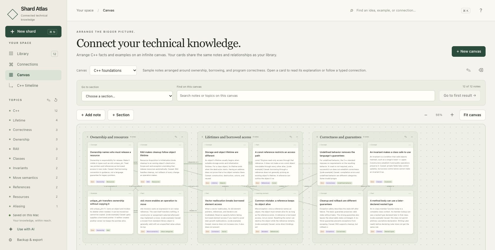

# Shard Atlas

**A local workspace for technical ideas and the connections between them.**

Write an explanation, keep the code and sources beside it, and connect it to what you already know. Shard Atlas brings notes, a connection map, and a freeform canvas into a macOS app that works offline.

[User guide](docs/guide.md) · [Development](docs/development.md) · [Contributing](CONTRIBUTING.md)


## From a note to a connected explanation

- **Keep the details.** Notes support Markdown, highlighted C++ code, mathematics, images, source references, and links to other notes.
- **Explain the relationship.** Connect ideas with labels such as *depends on*, *contrasts with*, and *is an example of*, with a reason for each connection.
- **Arrange your thinking.** Place shared notes on a canvas, group them into sections, and move between the overview and an individual explanation.
- **Keep your bearings.** Search and filter by topic, kind, or understanding. Explore the separate, sourced C++ release reference from C++98 through the C++26 working draft.


The same note can appear on several canvases. Editing its explanation updates the shared note, while moving a card only changes that canvas.



The included collection has **12 C++ notes, 18 connections, and one canvas**. It is a starting point to explore and replace with your own explanations. Shard Atlas also fits computer science, mathematics, and ML or AI theory.

## Build and open

The desktop app requires **macOS 12 or later**, **Python 3.10 or later**, and **Xcode Command Line Tools** to build. The app uses Python already installed on your machine. It does not bundle a Python interpreter. There are no pip or npm packages to install for the application.

```sh
git clone https://github.com/SebastianJeanF/shard-atlas.git
cd shard-atlas
python3 desktop/build.py
open "Shard Atlas.app"
```

If needed, install Xcode Command Line Tools with `xcode-select --install` and install a compatible Python interpreter before building. See [setup and troubleshooting](docs/development.md#build-the-desktop-app) for interpreter selection and isolated development.

This is currently a **source build**, signed locally during compilation. There is no notarized, self-contained download. The native window uses AppKit and WKWebView around a bundled local Python service.

## Your knowledge stays local

Your collection lives in SQLite under `~/Library/Application Support/Shard Atlas`, outside the source checkout. No account is required for the app, and your notes do not become part of this Git repository.

Saved revisions, Trash, automatic database snapshots, and JSON or Markdown exports provide recovery options. Backups are local files. Cloud backup requires configuring a destination that your own sync service uploads. See [storage, backups, and recovery](docs/guide.md#storage-backups-and-recovery) for locations and restore behavior.

The service listens on the local loopback interface. Shard Atlas is a personal desktop application without user authentication or a multiuser hosting mode. Do not expose its service to a network.

## Capture from an AI chat

**“Add this to Shard Atlas”** can save technical explanations and useful connections when your AI client has the optional local integration configured. The app's **Use with AI** guide explains the workflow. Without local access, a chat can prepare a portable JSON file for you to import.

The application does not automatically install tools into every AI service. See the [AI integration setup](docs/development.md#optional-ai-integration) and the [knowledge contribution guide](static/ai-instructions.md).

## Work on Shard Atlas

The project uses a Python standard-library storage service, plain JavaScript and CSS, and a Swift desktop wrapper. KaTeX is bundled for offline math rendering. See [development and architecture](docs/development.md) for the source map, tests, and data boundaries.

Contributions are welcome. Read [CONTRIBUTING.md](CONTRIBUTING.md) before changing persistence or importing personal data.

Shard Atlas is available under the [MIT license](LICENSE). Bundled third-party components retain their [own licenses](THIRD_PARTY_NOTICES.md).
